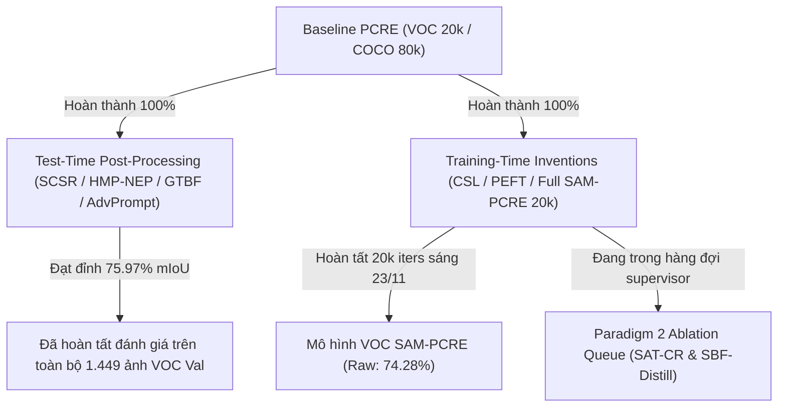

# WSSS-PCRE: Nghiên cứu & Cải tiến Phân đoạn Ngữ nghĩa Giám sát Yếu (Weakly Supervised Semantic Segmentation)

Dự án này kế thừa mã nguồn chính thức của bài báo CVPR 2025: **"Weakly Supervised Semantic Segmentation via Progressive Confidence Region Expansion" (PCRE)**. Thư mục này được sử dụng làm môi trường nghiên cứu thực nghiệm chuyên sâu, tái lập baseline, và phát triển các phương pháp đột phá mới nhằm nâng cao độ chính xác phân đoạn ngữ nghĩa từ nhãn mức ảnh (image-level tags) kết hợp với các mô hình nền tảng (**Foundation Models**) tiên tiến như **SAM (Segment Anything Model)** và **CLIP**.

---

## 1. Thư mục này có gì? (Cấu trúc Repository)

```text
WSSS-PCRE/
├── configs/              # Cấu hình thực nghiệm (JSON) cho baseline, adaptive, ablation
├── dataset/              # Chứa dữ liệu thực tế hoặc symlink tới VOCdevkit/VOC2012
├── datasets/             # Metadata danh sách ảnh, nhãn one-hot (train_aug.txt, val.txt, cls_labels_onehot.npy)
│   ├── voc/              # Split và nhãn cho PASCAL VOC 2012 (20 lớp + nền)
│   └── coco/             # Split và nhãn cho MS COCO 2014 (80 lớp + nền)
├── engine/               # Module xây dựng mạng nơ-ron, optimizer, scheduler và validation engine
│   ├── build_network.py  # Xây dựng backbone ViT-B và các nhánh dự đoán CAM/Segmentation
│   └── validatation_engine.py # Đánh giá mIoU, Confusion Matrix, CAM mIoU trên tập Val
├── experiments/          # Toàn bộ kết quả thực nghiệm, checkpoints, logs và báo cáo chi tiết
│   ├── coco_baseline/    # Baseline đầy đủ 80.000 iters trên MS COCO 2014
│   ├── pcre_sat_*/       # Baseline PCRE và các thực nghiệm Self-Adaptive Thresholding (FreeMatch)
│   ├── pcre_repair_*/    # Tinh chỉnh ngưỡng thích nghi consensus & ensemble
│   ├── decoder_selftrain_*/ # Huấn luyện tự giám sát decoder (Teacher-Student) với backbone đóng băng
│   ├── representation_sam_*/ # Huấn luyện tính bất biến biểu diễn (Consistency) & SAM pseudo-label
│   ├── precision_residual_*/ # Residual Head & Negative Prototype Filtering
│   ├── sam_cam_refinement_*/ # Phương pháp SCSR: Tinh lọc hậu xử lý bằng SAM Consensus
│   ├── hmp_nep_refinement_*/ # Phương pháp HMP-NEP: SAM đa điểm xương sống + Bảo vệ phi xói mòn
│   ├── gtbf_camr_refinement_*/ # Phương pháp GTBF-CAMR: Phân nhánh hình học 3 nhóm + Lọc biên màu
│   ├── csl_softmask_training_*/ # Huấn luyện phân tầng độ tin cậy với soft mask
│   ├── peft_csl_training_*/  # Tinh chỉnh tham số hiệu quả PEFT (LoRA) kết hợp CSL
│   ├── peft_csl_gtbf_synergy_*/ # Phối hợp mô hình PEFT-CSL và hậu xử lý GTBF
│   ├── sam_advanced_prompting_*/ # SAM Advanced Prompting (Negative points + Multi-mask disambiguation)
│   ├── sam_clip_synergy_*/   # Kết hợp SAM + Zero-shot CLIP xác thực chống đồng xuất hiện
│   ├── voc_sam_pcre/     # Huấn luyện toàn diện End-to-End PCRE với giám sát SAM (20.000 iters)
│   ├── voc_sam_pcre_v2/  # Khung nâng cấp tích hợp SAT-CR và SBF-Distill
│   ├── voc_sam_sat_cr/   # Thực nghiệm độc lập Stage 1: SAM-Affinity Token Contrastive
│   └── voc_sam_sbf_distill/ # Thực nghiệm độc lập Stage 2: SAM Boundary-Focal Distillation
├── model/                # Định nghĩa kiến trúc: ViT backbone, PAR (Pixel Affinity Refinement), CRME, CPE, Loss
├── pretrained/           # Thư mục chứa trọng số pretrained ImageNet ViT-B_16
├── scripts/              # Tập lệnh Python thực thi huấn luyện, supervisor hàng đợi GPU và chẩn đoán
├── tests/                # Bộ kiểm thử đơn vị tự động (Unit tests) bảo đảm tính toàn vẹn thuật toán
├── tools/                # Công cụ suy luận độc lập (infer_seg_voc.py) và tiền xử lý
├── utils/                # Tiện ích toán học, xử lý ảnh (imutils), CAM (camutils), SAM (sam_innovations)
├── ALL.sh                # Kịch bản cài đặt tự động toàn diện (môi trường, thư viện, pretrained weights)
├── TRAIN.sh              # Kịch bản điều phối huấn luyện tự động các tiến trình còn thiếu
├── train.sh              # Kịch bản khởi chạy huấn luyện mặc định của tác giả gốc
├── train_coco.sh         # Kịch bản phân tán 4 GPU cho COCO
├── train_voc_sam_pcre.sh # Kịch bản huấn luyện PCRE tích hợp SAM pseudo-labels
├── train_voc_sam_pcre_v2.sh # Kịch bản huấn luyện đầy đủ Paradigm 2 (SAT-CR + SBF-Distill)
├── train_voc_sam_sat_cr.sh  # Kịch bản huấn luyện riêng nhánh SAT-CR
└── train_voc_sam_sbf_distill.sh # Kịch bản huấn luyện riêng nhánh SBF-Distill
```

---

## 2. Hướng dẫn Tải & Cấu hình Tập Dữ liệu (Dataset Setup)

Tất cả các tập dữ liệu được quản lý tập trung bên trong thư mục `dataset/` tại gốc của repository này. Nếu bạn đã có sẵn dữ liệu ở thư mục khác trên máy chủ, có thể tạo **symlink** (liên kết mềm) để tiết kiệm dung lượng đĩa.

```text
dataset/
├── VOC2012/                  # Tập dữ liệu PASCAL VOC 2012 kèm nhãn mở rộng SBD
│   ├── Annotations/          # Nhãn XML bounding box
│   ├── ImageSets/            # Danh sách chia tập train/val
│   │   └── Segmentation/     # val.txt, train.txt
│   ├── JPEGImages/           # 17.125 ảnh gốc (.jpg)
│   ├── SegmentationClass/    # Nhãn phân đoạn gốc (.png)
│   ├── SegmentationClassAug/ # Nhãn mở rộng SBD (10.582 ảnh train_aug)
│   └── SegmentationObject/   # Nhãn theo từng vật thể
└── COCO2014/                 # Tập dữ liệu MS COCO 2014
    ├── annotations/          # instances_train2014.json, instances_val2014.json,...
    └── coco/
        ├── train2014/        # Ảnh train gốc (hoặc symlink: train -> train2014)
        ├── val2014/          # Ảnh val gốc (hoặc symlink: val -> val2014)
        └── SegmentationClass/ # Nhãn mask PNG dạng VOC (tạo từ annotations)
            └── val/          # Mask nhãn validation (COCO_val2014_*.png)
```

---

### 2.1. PASCAL VOC 2012 (+ SBD Augmentation)

#### Bước 1: Tải ảnh gốc và nhãn PASCAL VOC 2012
```bash
# Tạo thư mục dataset nếu chưa có
mkdir -p dataset
cd dataset

# Tải bộ VOCtrainval (khoảng 2 GB)
wget http://host.robots.ox.ac.uk/pascal/VOC/voc2012/VOCtrainval_11-May-2012.tar
tar -xvf VOCtrainval_11-May-2012.tar
# Sau khi giải nén sẽ có thư mục VOCdevkit/VOC2012, đổi tên/chuyển thành dataset/VOC2012:
mv VOCdevkit/VOC2012 ./VOC2012
rm -rf VOCdevkit VOCtrainval_11-May-2012.tar
cd ..
```

#### Bước 2: Tải nhãn mở rộng SegmentationClassAug (SBD Benchmark)
Để đạt tập huấn luyện 10.582 ảnh (`train_aug`), cần bổ sung nhãn từ Semantic Boundaries Dataset (SBD):
```bash
# Tải tệp nhãn SBD Benchmark
wget https://www.dropbox.com/s/g3twnwcrsmhpaze/SegmentationClassAug.zip -O dataset/SegmentationClassAug.zip
# hoặc từ mirror: http://home.bharathh.info/pubs/codes/SBD/download.html

unzip dataset/SegmentationClassAug.zip -d dataset/VOC2012/
rm dataset/SegmentationClassAug.zip
```
> [!TIP]
> **Nếu dữ liệu VOC2012 đã có sẵn trên máy chủ**, bạn không cần tải lại mà chỉ cần tạo symlink:
> ```bash
> mkdir -p dataset
> ln -s /duong/dan/toi/VOC2012 dataset/VOC2012
> ```

#### Bước 3: Khởi tạo danh sách phân chia và nhãn cấp ảnh
Sau khi thư mục `dataset/VOC2012/` đã đầy đủ, chạy kịch bản để tạo metadata tại `datasets/voc/`:
```bash
python scripts/prepare_voc.py \
    --data_folder ./dataset/VOC2012 \
    --train_list ./datasets/voc/train_aug.txt \
    --output datasets/voc
```
Kịch bản sẽ tự động tạo `train_aug.txt`, `val.txt` và tệp nhãn one-hot `cls_labels_onehot.npy`.

---

### 2.2. MS COCO 2014

#### Bước 1: Tải ảnh và tệp Annotations
```bash
mkdir -p dataset/COCO2014/coco
cd dataset/COCO2014

# Tải ảnh train, val và annotations
wget http://images.cocodataset.org/zips/train2014.zip
wget http://images.cocodataset.org/zips/val2014.zip
wget http://images.cocodataset.org/annotations/annotations_trainval2014.zip

# Giải nén ảnh vào dataset/COCO2014/coco/
unzip train2014.zip -d coco/
unzip val2014.zip -d coco/

# Giải nén annotations vào dataset/COCO2014/
unzip annotations_trainval2014.zip

# Dọn dẹp tệp nén
rm train2014.zip val2014.zip annotations_trainval2014.zip
cd ../..
```

#### Bước 2: Tạo liên kết mềm thuận tiện (Symlink)
Một số script yêu cầu đường dẫn `coco/train` và `coco/val`:
```bash
cd dataset/COCO2014/coco
ln -s train2014 train
ln -s val2014 val
cd ../../..
```

#### Bước 3: Sinh mặt nạ phân đoạn dạng VOC (SegmentationClass) và Metadata COCO
Chạy kịch bản chuẩn bị dữ liệu COCO tích hợp sẵn trong repo:
```bash
python scripts/prepare_coco.py
```
Kịch bản này sẽ:
1. Đọc tệp chú thích `annotations/instances_val2014.json`.
2. Tự động trích xuất danh sách `val_part.txt` và `val.txt` vào `datasets/coco/`.
3. Sinh các mặt nạ ground-truth dạng ảnh PNG vào `dataset/COCO2014/coco/SegmentationClass/val/`.
4. Tạo tệp nhãn phân loại một-nhiều `cls_labels_onehot.npy` cho 80 lớp đối tượng COCO.

---

## 3. Thư mục này đang làm gì?

Thư mục này đang thực hiện một chuỗi nghiên cứu và thử nghiệm có hệ thống gồm các mục tiêu chính:

1. **Tái lập và thiết lập Baseline chuẩn (Benchmarking):**
   - Chạy lại mô hình PCRE chính quy từ bài báo CVPR 2025 trên **Pascal VOC 2012** (20.000 iterations) để làm chuẩn đối chứng tuyệt đối (74.22% CRF mIoU).
   - Chạy đầy đủ baseline trên tập dữ liệu quy mô lớn **MS COCO 2014** (80.000 iterations trên 4 GPU).
2. **Nghiên cứu Can thiệp ở Bước Huấn Luyện (Training-Time Innovations):**
   - Giải quyết vấn đề rò rỉ vùng kích hoạt của CAM sang nền bằng cách cải tiến cơ chế tạo nhãn giả (pseudo-label generation), áp dụng ngưỡng thích nghi (SAT), tự huấn luyện decoder (Teacher-Student self-training), phân tầng độ tin cậy (CSL), chèn PEFT/LoRA vào ViT backbone, và nhúng mặt nạ hình học từ SAM trực tiếp vào hàm mất mát (Token Contrastive Regularization & Boundary-Focal Distillation).
3. **Nghiên cứu Can thiệp ở Bước Kiểm Thử / Hậu Xử Lý (Test-Time / Post-Processing Refinement):**
   - Khai thác sức mạnh Zero-Shot của **Segment Anything Model (SAM)** và **CLIP** để tinh chỉnh đường biên và phân định ngữ nghĩa cho các dự đoán phân đoạn từ mô hình đã huấn luyện.
   - Phát triển các kỹ thuật kích hoạt điểm thông minh (Medial Axis Skeleton Prompting), bảo vệ ngữ cảnh phi xói mòn (Non-Erosive Context Protection), phân nhánh 3 hình thái cấu trúc (Tripartite Branching), và cổng màu gradient (Color-Gradient Gating).

---

## 4. Bảng tổng hợp các thực nghiệm đã chạy

Dưới đây là danh sách đầy đủ tất cả các thực nghiệm đã được triển khai, phân loại rõ ràng theo **giai đoạn can thiệp (Train / Test)**, kết quả mIoU đạt được và độ chênh lệch ($\Delta$) so với Baseline chuẩn:

| STT | Tên phương pháp | Bước can thiệp | Mô tả tóm tắt cơ chế | mIoU đạt được (%) | $\Delta$ vs Baseline (pp) | Trạng thái |
| :---: | :--- | :---: | :--- | :---: | :---: | :---: |
| **0** | **Baseline PCRE (VOC 20k)** | **Train** | Baseline chuẩn từ bài báo gốc CVPR 2025 (ViT-B, 20.000 bước, seed 0). | **Raw: 73.79%<br>CRF: 74.22%** | **0.00** *(Mốc chuẩn)* | Hoàn thành |
| - | **Baseline PCRE (COCO 80k)** | **Train** | Chạy 80.000 bước phân tán trên MS COCO 2014 (Validation online: Seg 30.78%, CAM1 36.10%; đánh giá chính thức multi-scale + CRF sẽ được thực hiện sau). | **Seg: 30.78%<br>CAM1: 36.10%** | — | Hoàn thành |
| **I** | **CÁC PHƯƠNG PHÁP CAN THIỆP BƯỚC KIỂM THỬ (TEST-TIME / POST-PROCESSING)** | | | | | |
| 1 | **SCSR (SAM-CAM Consensus Semantic Refinement)** | **Test** | Peak Point Prompt (EDT) + Box Prompt (padding 8px) + Lọc đồng thuận SAM (Score>0.85, IoU>0.65) + Cắt tỉa biên. | **75.66%** | <span style="color:green">**+1.43**</span> | Hoàn thành |
| 2 | **HMP-NEP (Hierarchical Multi-Prompt Part-Whole SAM)** | **Test** | Prompt đa điểm trục xương sống (Medial Axis) + Bảo vệ phi xói mòn (NEP) chống mất mát các lớp articulated (person, bike, table). | **75.70%** | <span style="color:green">**+1.48**</span> | Hoàn thành |
| 3 | **GTBF-CAMR (Geometric-Topological Boundary Fusion)** | **Test** | Phân nhánh 3 hình thái (Hollow: chỉ điểm, Composite: NEP, Solid: Box+Trim) + Lọc biên sai biệt màu RGB + Vá lỗ rỗng tô pô. | **75.85%** | <span style="color:green">**+1.63**</span> | Hoàn thành |
| 4 | **PEFT-CSL + GTBF Synergy** | **Train + Test** | Mô hình huấn luyện bằng PEFT-CSL kết hợp tinh chỉnh hậu xử lý bằng thuật toán hình học GTBF. | **75.88%** | <span style="color:green">**+1.66**</span> | Hoàn thành |
| 5 | **SAM Advanced Prompting** | **Test** | Tinh chỉnh trên PEFT-CSL bằng Negative Point Prompts để tách vật thể dính nhau + Giải quyết đa nghĩa mặt nạ SAM. | **75.97%** | <span style="color:green">**+1.75**</span> | Hoàn thành *(Đỉnh cao nhất)* |
| 6 | **SAM + CLIP Synergy** | **Test** | Lấy kết quả từ SAM Advanced Prompting kết hợp Zero-shot CLIP để xác thực và loại bỏ nhầm lẫn đồng xuất hiện. | **75.89%** | <span style="color:green">**+1.67**</span> | Hoàn thành |
| 7 | **Two-Model Ensemble** | **Test** | Kết hợp phân phối xác suất dự đoán của mô hình Baseline và Adaptive Consensus. | **74.32%** | <span style="color:green">**+0.10**</span> | Hoàn thành |
| **II** | **CÁC PHƯƠNG PHÁP CAN THIỆP BƯỚC HUẤN LUYỆN (TRAINING-TIME INNOVATIONS)** | | | | | |
| 8 | **PCRE + SAT (Self-Adaptive Thresholding)** | **Train** | Chuẩn hóa điểm kích hoạt CAM thích nghi (FreeMatch-style EMA theo từng lớp) áp dụng trước PAR. | **Raw: 72.96%<br>CRF: 73.44%** | <span style="color:red">-0.78</span> | Hoàn thành |
| 9 | **Adaptive Consensus Repair** | **Train** | Hiệu chỉnh lịch warm-up và sửa cơ chế consensus thresholding cho các lớp yếu. | **Raw: 73.15%<br>CRF: 73.72%** | <span style="color:red">-0.51</span> | Hoàn thành |
| 10 | **Decoder Self-Training (Raw vs CRF Teacher)** | **Train** | Đóng băng ViT backbone, chỉ fine-tune ASPP decoder 3.000 bước bằng pseudo-label từ teacher và loss KL. | **Raw Teacher: 74.19%<br>CRF Teacher: 74.20%** | <span style="color:red">-0.03</span> | Hoàn thành |
| 11 | **Representation Consistency & SAM Pseudo-Label** | **Train** | Mở 2 block ViT cuối + decoder, 4.000 bước, học tính bất biến weak/strong view kết hợp nhãn đề xuất từ SAM. | **Last2 Cons: 74.07%<br>Last2 SAM: 74.11%** | <span style="color:red">-0.12</span> | Hoàn thành |
| 12 | **Precision Residual Head & Negative Filtering** | **Train** | Head residual zero-init đóng băng backbone; chắt lọc negative prototypes phủ định lỗi sai lầm. | **A1 Control: 74.27%<br>Detail Residual: 74.29%** | <span style="color:green">**+0.06**</span> | Hoàn thành |
| 13 | **FBSD (Frequency Boundary & Semantic Decoupling)** | **Train** | Fine-tune decoder 2.000 bước với cơ chế phân tách tần số biên và ngữ nghĩa. | **Raw: 73.79%<br>CRF: 74.26%** | <span style="color:green">**+0.03**</span> | Hoàn thành |
| 14 | **USRC (Uncertainty-Guided Selective Rectification)** | **Train** | Đánh giá class risk profile, áp dụng loss chọn lọc dựa trên độ bất định. | **Raw: 73.73%<br>CRF: 74.17%** | <span style="color:red">-0.05</span> | Hoàn thành |
| 15 | **CSL-SoftMask (Confidence-Stratified Learning)** | **Train** | Phân tầng độ tin cậy của nhãn giả và huấn luyện mềm (soft-mask supervision). | **Raw: 73.87%<br>CRF: 74.32%** | <span style="color:green">**+0.10**</span> | Hoàn thành |
| 16 | **PEFT-CSL (LoRA ViT + CSL)** | **Train** | Gắn LoRA adapters vào các tầng Attention của ViT backbone, kết hợp hàm mất mát CSL. | **Raw: 73.89%<br>CRF: 74.36%** | <span style="color:green">**+0.13**</span> | Hoàn thành *(Mô hình train tốt nhất)* |
| 17 | **VOC SAM-PCRE (Full Retraining 20k iters)** | **Train** | Tái huấn luyện toàn bộ mô hình end-to-end 20.000 bước sử dụng SAM pseudo-label thay thế CAM target. | **Raw Seg: 74.28%<br>CAM1: 76.99%** | <span style="color:green">**+0.49**</span> *(so với raw baseline)* | Hoàn thành |
| 18 | **Paradigm 2 - Stage 1: SAT-CR** | **Train** | Làm sạch ma trận patch-token affinity (aff_mask) trong ViT Backbone dựa trên độ thuần khiết của SAM patch. | *Đang chờ GPU* | — | Đang trong hàng đợi |
| 19 | **Paradigm 2 - Stage 2: SBF-Distill** | **Train** | Trọng số hóa hàm mất mát phân đoạn CE bằng dải Gaussian làm mịn quanh đường biên của SAM (alpha=2.0). | *Đang chờ GPU* | — | Đang trong hàng đợi |

---

## 5. Chi tiết các nghiên cứu nổi bật

### 5.1. Hướng Đột Phá Test-Time Refinement với Foundation Model (SAM / CLIP)
Các phương pháp can thiệp ở bước kiểm thử đem lại mức tăng mIoU vượt bậc mà không làm biến dạng biểu diễn đặc trưng của mô hình đã hội tụ:
- **SAM Advanced Prompting (75.97% mIoU, +1.75 pp):** Đạt kết quả cao nhất toàn dự án. Sử dụng các điểm âm (negative points) đặt vào các vùng biên tranh chấp để ngăn SAM mở rộng sai lớp, kết hợp cơ chế giải quyết đa nghĩa mặt nạ (Multi-mask Ambiguity Resolution).
- **GTBF-CAMR (75.85% mIoU, +1.63 pp):** Giải quyết triệt để vấn đề xói mòn đối tượng rỗng (nan hoa xe đạp, chân ghế) nhờ nhánh Slender chỉ dùng điểm, bảo toàn vật thể phức tạp (người, bàn) bằng cơ chế NEP, và tự động bịt kín các lỗ rỗng nội bộ (cửa sổ xe bus, kính tàu hỏa).
- **HMP-NEP (75.70% mIoU, +1.48 pp):** Đột phá với cơ chế Non-Erosive Context Protection, đảo ngược hiện tượng sụt giảm recall của các lớp phức tạp.
- **SCSR (75.66% mIoU, +1.43 pp):** Vượt qua mốc công bố 75.5% trong bài báo gốc CVPR 2025 với tốc độ xử lý nhanh (~11 ảnh/giây).

### 5.2. Hướng Đột Phá Training-Time (PEFT-CSL & End-to-End SAM-PCRE)
- **PEFT-CSL (74.36% CRF mIoU):** Bằng cách giữ phần lớn trọng số ViT đã được huấn luyện tốt và chỉ cập nhật các adapter LoRA kết hợp hàm mất mát phân tầng độ tin cậy CSL, mô hình hạn chế hiện tượng trôi kiến thức (catastrophic forgetting) và cải thiện độ chuẩn xác của nhãn giả.
- **VOC SAM-PCRE Full Training (74.28% Raw mIoU):** Huấn luyện lại từ đầu 20.000 bước với SAM pseudo-labels giúp mô hình đạt raw mIoU (trước khi áp dụng DenseCRF) lên tới **74.28%**, vượt trội so với raw baseline (73.79%) tới **+0.49 điểm phần trăm**, đồng thời CAM1 đạt đỉnh **76.99%**.

---

## 6. Tiến trình hiện tại (Current Status)



1. **Các tác vụ đã hoàn thành 100%:**
   - Baseline Pascal VOC 2012 (20.000 iters) và Baseline MS COCO 2014 (80.000 iters).
   - Toàn bộ chuỗi thực nghiệm hậu xử lý Test-time (SCSR, HMP-NEP, GTBF-CAMR, SAM Advanced Prompting, SAM-CLIP Synergy) trên 1.449 ảnh VOC Val.
   - Các biến thể huấn luyện tự giám sát: Decoder self-training, Representation consistency, Residual negative learning, FBSD, USRC, CSL, PEFT-CSL.
   - Huấn luyện End-to-End VOC SAM-PCRE (20.000 iters) đã hoàn thành vào rạng sáng ngày **23/11/2026** (kết quả ghi nhận tại `experiments/voc_sam_pcre/live_run.log`).
2. **Tiến trình đang chạy ngầm (Active Queue):**
   - Bộ điều phối hàng đợi độc lập `scripts/run_independent_queue.py` (PID `342111`) đang chạy để thực thi tuần tự 2 nhánh nghiên cứu của **Paradigm 2**:
     - **Giai đoạn 1:** `train_voc_sam_sat_cr.sh` (SAT-CR đơn lẻ) $\rightarrow$ lưu vào `experiments/voc_sam_sat_cr/`.
     - **Giai đoạn 2:** `train_voc_sam_sbf_distill.sh` (SBF-Distill đơn lẻ) $\rightarrow$ lưu vào `experiments/voc_sam_sbf_distill/`.
   - **Tình trạng tài nguyên:** Tiến trình supervisor đang thăm dò và chờ GPU có tối thiểu 16.000 MiB VRAM trống để tự động kích hoạt quá trình huấn luyện mà không xung đột với các tiến trình khác trên hệ thống.
3. **Kế hoạch tiếp theo (Planned Work):**
   - Đánh giá chính thức checkpoint MS COCO 80.000 iters bằng `tools/infer_seg_coco.py` (Multi-scale + Horizontal Flip + DenseCRF trên toàn bộ tập Val COCO) để chuẩn hóa số liệu so với mốc 47.2% công bố trong bài báo gốc.
   - Hoàn tất kiểm thử và phân tích kết quả của hai nhánh độc lập thuộc Paradigm 2 (SAT-CR và SBF-Distill).

---

## 7. Hướng dẫn Tái lập & Thực thi

### 7.1. Cài đặt toàn bộ hệ thống bằng 1 lệnh duy nhất (`ALL.sh`)
Khuyến nghị tạo môi trường ảo Python 3.10, 3.11 hoặc 3.12 (khuyên dùng **Python 3.12**) để tương thích hoàn toàn với tất cả các thư viện C++ mở rộng như `pydensecrf2`:
```bash
conda create -n wsss python=3.12 -y
conda activate wsss
```

Sau đó chỉ cần chạy một lệnh sau, kịch bản sẽ tự động cài đặt các gói Python, thư viện Foundation Models (SAM, CLIP, pydensecrf), tải trọng số tiền huấn luyện ViT-B/SAM, thiết lập thư mục và chạy kiểm thử:
```bash
./ALL.sh
```

### 7.2. Huấn luyện các tiến trình còn thiếu bằng 1 lệnh duy nhất (`TRAIN.sh`)
Kịch bản này tự động phát hiện và thực thi các giai đoạn chưa có kết quả (tự động bỏ qua các giai đoạn đã hoàn thành để tránh ghi đè):
```bash
# Kiểm tra trạng thái các tiến trình hiện tại (Đã xong hay Chưa xong)
./TRAIN.sh --status

# Chạy tuần tự tất cả các tiến trình chưa hoàn thành
./TRAIN.sh

# Hoặc chạy kèm chế độ tự động chờ GPU đủ VRAM (>= 16 GB)
./TRAIN.sh --wait

# Hoặc chạy riêng lẻ từng giai đoạn cụ thể:
./TRAIN.sh --stage 1       # Stage 1: SAT-CR
./TRAIN.sh --stage 2       # Stage 2: SBF-Distill
./TRAIN.sh --stage 3       # Stage 3: Full Paradigm 2
./TRAIN.sh --coco-eval     # Đánh giá chính thức COCO 80k (Multi-scale + DenseCRF)
```

### 7.3. Đánh giá kiểm thử hậu xử lý (Test-Time Refinement)
Để chạy phương pháp tối ưu biên hình học SAM trên tập VOC 2012 Val:
```bash
# Phương pháp GTBF-CAMR (75.85% mIoU)
python experiments/gtbf_camr_refinement_20261121/run_gtbf_camr.py

# Phương pháp SAM Advanced Prompting (75.97% mIoU)
bash run_two_directions.sh
```

### 7.4. Kiểm tra trạng thái hàng đợi và chạy Unit Tests
```bash
# Kiểm tra log tiến trình hàng đợi độc lập đang chạy
tail -f experiments/independent_ablation_queue.log

# Kiểm tra log huấn luyện tổng hợp
tail -f experiments/train_pipeline.log

# Chạy kiểm thử đơn vị tự động
python -m unittest discover -s tests -p "test_sam_innovations.py"
```
